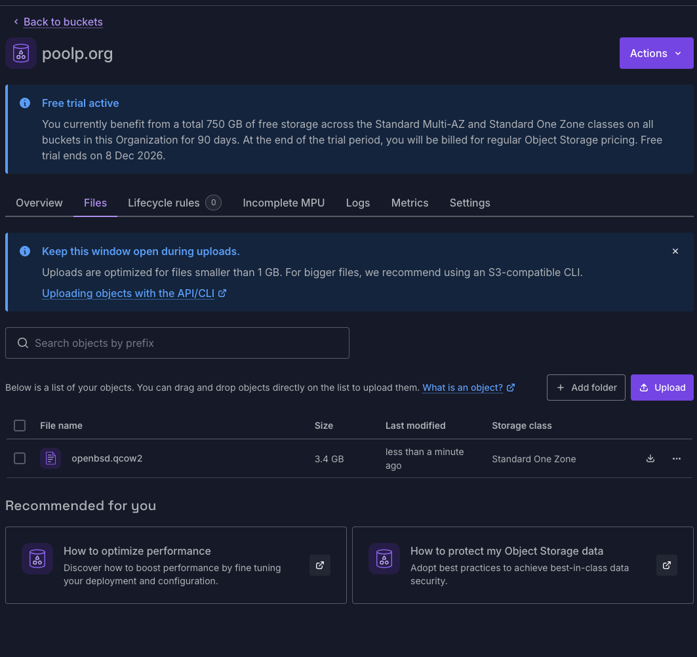
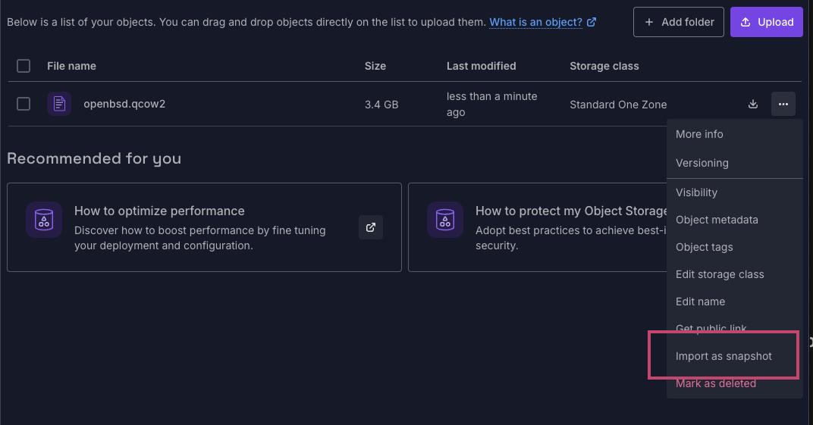
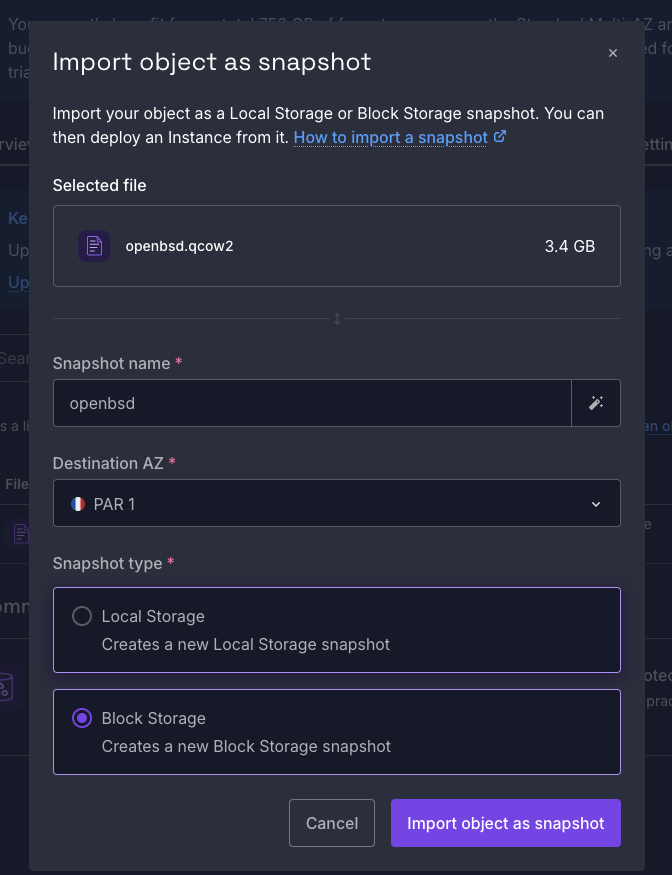
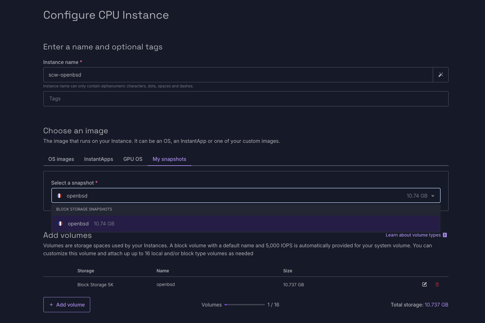
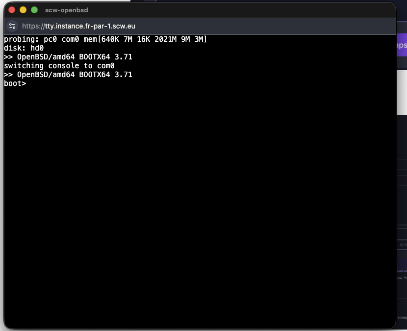
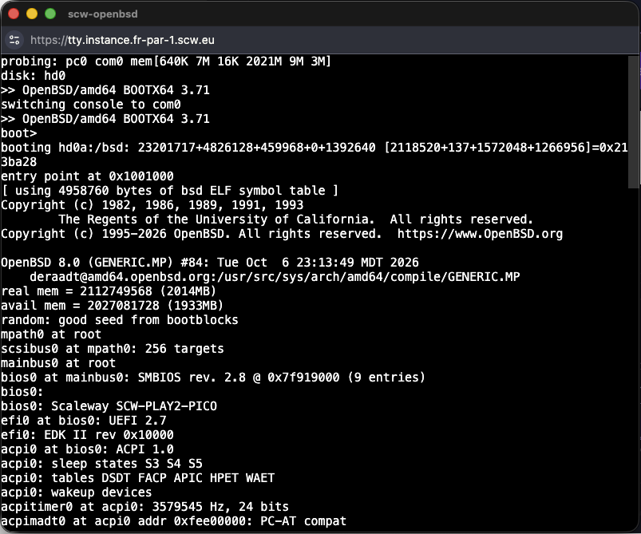
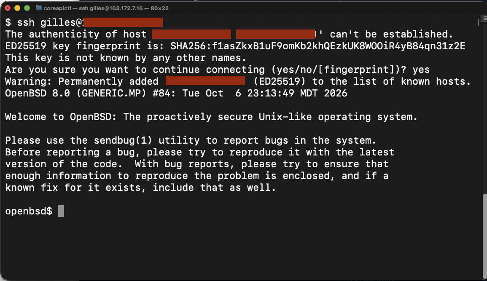


Every few years I want to install OpenBSD at Scaleway...
but they don't support OpenBSD and I need to find a way to install regardless.


## Here we go again...

Since early 2010,
I've been a regular customer of Dedibox then Scaleway,
particularly because they're very geeky and also because I've always personally known people working there which proves helpful at times :-)

Sadly,
they never officially supported OpenBSD and I always had to play tricks to boot my machines.
This prompted two articles on this blog,
one in [2013](/fr/posts/2013-05-08/installer-openbsd-sur-une-dedibox-classic-gen2/) and the other in [2018](/posts/2018-01-29/install-openbsd-on-dedibox-with-full-disk-encryption/),
sharing how I did my installs there.

Around 2015, I moved most of my stuff to Vultr as they officially supported OpenBSD,
but after 11 years there I got fed up with their services and decided to come back to Scaleway.

A lot of things have changed since I left,
but one thing that hasn't is that in 2026 they still don't support OpenBSD as an official target.
Scaleway's catalog of images has the usual suspects:
Debian, Ubuntu, Rocky, a few appliances, but no BSD in sight.

Well,
I'll be damned if I have to install a Linux distribution for my personal use,
so here we go again: 2026, a new guide on how to install OpenBSD at Scaleway !

## Installing a custom operating system

Scaleway lets you bring your own operating system,
just not the easy way:
there is no "attach an ISO and boot from it" button.

Instead what you can do is upload a disk image to Object Storage,
import it as a Block Storage snapshot,
turn that snapshot into an Instance image,
and boot an instance from it.

Luckily for me,
this is something we had to do about a thousand times at Plakar Korp so I've become fairly intimate with the process :-)

Two constraints come with this:

- the image must be a **full disk** in qcow2 format, partition table and bootloader included, not a filesystem and not an installer;
- Instances boot **UEFI only**, so the disk must carry a GPT and an EFI system partition, and the operating system must have been installed under UEFI.

Also,
as a final note for the reader,
Scaleway is upfront that custom images are not supported,
you're on your own if it doesn't boot.
For production,
this is typically not what you want to read,
but for our own case here it's fair and exactly what we're in for !

## OpenBSD doesn't do cloud images

Most Linux distributions publish a ready-made cloud disk image with `cloud-init` in it.
Old-school OpenBSD doesn't,
it publishes an installer ISO, a USB image and sets,

So my plan is simple:
run the installer in a VM on my desktop,
install onto a virtual disk the way Scaleway would like it,
ship that disk,
convert it to a Scaleway snapshot and boot an instance using that snapshot as its system block device.

The desktop here is an Apple-silicon Mac Mini.
The target is an x86_64 instance type.
That means `qemu-system-x86_64` running in full emulation,
no hardware acceleration,
and it is slow.
Slow as in "go make coffee while the sets extract" slow.
It's fine, it's a one-time thing.
Also... I'm on a coffee cut so I'll just watch the terminal progress slowly.

## Building the disk

Homebrew's qemu comes with the EDK2 OVMF firmware,
which is what gives me a UEFI boot in a VM:

```bash
$ brew install qemu
$ curl -O https://cdn.openbsd.org/pub/OpenBSD/8.0/amd64/install80.iso
$ qemu-img create -f qcow2 openbsd.qcow2 10G
```

Then I can boot the installer with the UEFI firmware as a pflash drive,
the qcow2 as a virtio disk,
the ISO as cdrom,
user-mode networking,
and no graphics because I want everything on the terminal:

```bash
qemu-system-x86_64 \
    -m 2048 -smp 2 \
    -drive if=pflash,format=raw,readonly=on,file=/opt/homebrew/share/qemu/edk2-x86_64-code.fd \
    -drive file=openbsd.qcow2,if=virtio \
    -cdrom install80.iso \
    -boot d \
    -netdev user,id=n0 -device virtio-net,netdev=n0 \
    -nographic
```

Two things worth noting.
The disk is 10G because that's the snapshot size I'll declare at import,
it's also the default size of system block devices on new instances,
and for my OCD it costs nothing to keep them equal.
The disk is virtio because that's what Scaleway exposes,
so the installed system sees the same `sd0` at both ends.

## Hang in there (pun intended)

The firmware comes up,
the OpenBSD bootloader comes up,
I celebrate internally as I see `booting ...` and `entry point at 0x1001000`,
and then... nothing.

For a good minute I was convinced the emulation had died or the kernel had hanged.

Nope, it hadn't.
Under UEFI the kernel console goes to the EFI framebuffer,
the one I had just told qemu not to display with `-nographic`.
The kernel was happily running the installer on a screen nobody was looking at.

The fix is to interrupt the countdown at the `boot>` prompt and redirect the console to the serial port before booting:

```
boot> set tty com0
boot> boot
```

After that the whole installer shows up on the terminal.
This only matters for the install media,
the installer itself will take care of the installed system.


## The installer answers that matter

Most of the installer is the usual OpenBSD experience,
I hit enter and move on.

```
>> OpenBSD/amd64 BOOTX64 3.71
boot> boot
cannot open cd0a:/etc/random.seed: No such file or directory
booting cd0a:/8.0/amd64/bsd.rd: 4387730+1852417+3896264+0+716800 [118+503808+355282]=0xb2e010
entry point at 0x1001000

[...]

Welcome to the OpenBSD/amd64 8.0 installation program.
(I)nstall, (U)pgrade, (A)utoinstall or (S)hell? i
At any prompt except password prompts you can escape to a shell by
typing '!'. Default answers are shown in []'s and are selected by
pressing RETURN.  You can exit this program at any time by pressing
Control-C, but this can leave your system in an inconsistent state.

Terminal type? [vt220] 
System hostname? (short form, e.g. 'foo') openbsd

Available network interfaces are: vio0 vlan0.
Network interface to configure? (name, lladdr, '?', or 'done') [vio0] 
IPv4 address for vio0? (or 'autoconf' or 'none') [autoconf] 
IPv6 address for vio0? (or 'autoconf' or 'none') [autoconf] 
Available network interfaces are: vio0 vlan0.
Network interface to configure? (name, lladdr, '?', or 'done') [done] 
Using DNS domainname my.domain
Using DNS nameservers at 10.0.2.3 fec0::3

Password for root account? (will not echo) 
Password for root account? (again) 
Start sshd(8) by default? [yes] 
Do you want the X Window System to be started by xenodm(1)? [no] 
Change the default console to com0? [yes] 
Available speeds are: 9600 19200 38400 57600 115200.
Which speed should com0 use? (or 'done') [9600] 115200
Setup a user? (enter a lower-case loginname, or 'no') [no] gilles
Full name for user gilles? [gilles] 
Password for user gilles? (will not echo) 
Password for user gilles? (again) 
WARNING: root is targeted by password guessing attacks, pubkeys are safer.
Allow root ssh login? (yes, no, prohibit-password) [no] 
What timezone are you in? ('?' for list) [Europe/Paris] 

Available disks are: sd0.
Which disk is the root disk? ('?' for details) [sd0] 
Encrypt the root disk with a (p)assphrase or (k)eydisk? [no] 
No valid MBR or GPT.
Use (W)hole disk MBR, whole disk (G)PT or (E)dit? [gpt] G
Setting OpenBSD GPT partition to whole sd0...done.
The auto-allocated layout for sd0 is:
#                size           offset  fstype [fsize bsize   cpg]
  a:          1177.2M           532544  4.2BSD   2048 16384     1 # /
  b:           256.0M          2943424    swap                    
  c:         10240.0M                0  unused                    
  d:          3072.0M          3467712  4.2BSD   2048 16384     1 # /usr
  e:          2048.0M          9759168  4.2BSD   2048 16384     1 # /home
  i:           260.0M               64   MSDOS                    
Use (A)uto layout, (E)dit auto layout, or create (C)ustom layout? [a] 
/dev/rsd0a: 1177.2MB in 2410880 sectors of 512 bytes
6 cylinder groups of 202.50MB, 12960 blocks, 25920 inodes each
/dev/rsd0e: 2048.0MB in 4194304 sectors of 512 bytes
11 cylinder groups of 202.50MB, 12960 blocks, 25920 inodes each
/dev/rsd0d: 3072.0MB in 6291456 sectors of 512 bytes
16 cylinder groups of 202.50MB, 12960 blocks, 25920 inodes each
/dev/sd0a (eb3ffee5c6bde0c5.a) on /mnt type ffs (rw, asynchronous, local)
/dev/sd0e (eb3ffee5c6bde0c5.e) on /mnt/home type ffs (rw, asynchronous, local, nodev, nosuid)
/dev/sd0d (eb3ffee5c6bde0c5.d) on /mnt/usr type ffs (rw, asynchronous, local, nodev)

Let's install the sets!
Location of sets? (cd0 disk http nfs or 'done') [http] 
HTTP proxy URL? (e.g. 'http://proxy:8080', or 'none') [none] 
HTTP Server? (hostname, list#, 'done' or '?') [cdn.openbsd.org] 
Server directory? [pub/OpenBSD/8.0/amd64] 

Select sets by entering a set name, a file name pattern or 'all'. De-select
sets by prepending a '-', e.g.: '-game*'. Selected sets are labelled '[X]'.
    [X] bsd           [X] base80.tgz    [X] game80.tgz    [X] xfont80.tgz
    [X] bsd.mp        [X] comp80.tgz    [X] xbase80.tgz   [X] xserv80.tgz
    [X] bsd.rd        [X] man80.tgz     [X] xshare80.tgz
Set name(s)? (or 'abort' or 'done') [done] 
Get/Verify SHA256.sig   100% |**************************|  2144       00:00    
Signature Verified
Get/Verify bsd          100% |**************************| 32494 KB    00:01    
Get/Verify bsd.mp       100% |**************************| 32653 KB    00:01    
Get/Verify bsd.rd       100% |**************************|  4782 KB    00:00    
Get/Verify base80.tgz   100% |**************************|   530 MB    00:29    
Get/Verify comp80.tgz   100% |**************************|    99 MB    00:05    
Get/Verify man80.tgz    100% |**************************|  8417 KB    00:00    
Get/Verify game80.tgz   100% |**************************|  2743 KB    00:00    
Get/Verify xbase80.tgz  100% |**************************| 47568 KB    00:02    
Get/Verify xshare80.tgz 100% |**************************|  4568 KB    00:00    
Get/Verify xfont80.tgz  100% |**************************| 23022 KB    00:01    
Get/Verify xserv80.tgz  100% |**************************| 11739 KB    00:00    
Get/Verify BUILDINFO    100% |**************************|    54       00:00    
Installing bsd          100% |**************************| 32494 KB    00:00    
Installing bsd.mp       100% |**************************| 32653 KB    00:00    
Installing bsd.rd       100% |**************************|  4782 KB    00:00    
Installing base80.tgz   100% |**************************|   530 MB    00:53    
Extracting etc.tgz      100% |**************************|   243 KB    00:00    
Installing comp80.tgz   100% |**************************|    99 MB    00:13    
Installing man80.tgz    100% |**************************|  8417 KB    00:01    
Installing game80.tgz   100% |**************************|  2743 KB    00:00    
Installing xbase80.tgz  100% |**************************| 47568 KB    00:06    
Extracting xetc.tgz     100% |**************************|  8717       00:00    
Installing xshare80.tgz 100% |**************************|  4568 KB    00:01    
Installing xfont80.tgz  100% |**************************| 23022 KB    00:02    
Installing xserv80.tgz  100% |**************************| 11739 KB    00:01    
Installing BUILDINFO    100% |**************************|    54       00:00    
Location of sets? (cd0 disk http nfs or 'done') [done] 
Saving configuration files... done.
Making all device nodes... done.
Multiprocessor machine; using bsd.mp instead of bsd.
fw_update: add none; update none
Relinking to create unique kernel... done.

CONGRATULATIONS! Your OpenBSD install has been successfully completed!

When you login to your new system the first time, please read your mail
using the 'mail' command.

Exit to (S)hell, (H)alt or (R)eboot? [reboot] s
To boot the new system, enter 'reboot' at the command prompt.

openbsd# cd /mnt/home/gilles/.ssh
openbsd# echo ssh-ed25519 AAAAC3NzaC1lZDI1NTE5AAAAII19dxt4hf1t4Lo05TaPZQqrtwtszHHyAF7ctPYPRIvp gilles@debug.poolp.org >> authorized_keys                                       <
openbsd# cat /mnt/home/gilles/.ssh/authorized_keys                                                   
ssh-ed25519 AAAAC3NzaC1lZDI1NTE5AAAAII19dxt4hf1t4Lo05TaPZQqrtwtszHHyAF7ctPYPRIvp gilles@debug.poolp.org                                  
openbsd# exit
erase ^?, werase ^W, kill ^U, intr ^C, status ^T

Welcome to the OpenBSD/amd64 8.0 installation program.
(I)nstall, (U)pgrade, (A)utoinstall or (S)hell? s
openbsd# halt
halt: halted by root
syncing disks... done

The operating system has halted.
Please press any key to reboot.
```

A few answers need careful attention because the instance will have no screen and no keyboard,
only a serial console and SSH:

- **Change the default console to com0 ? yes, 115200**.
  This writes `/etc/boot.conf` with the same `set tty com0`,
  so the installed system does the right thing on its own and Scaleway's serial console works.
  We already did that in previous guides.
- **Network interface: vio0, autoconf**.
  Scaleway hands out the address over DHCP.
- **Disk: sd0, whole disk, GPT, auto layout**.
  The installer offers GPT when it detects it booted under UEFI,
  and it creates the EFI system partition for you.
  This is the part that makes the image bootable at Scaleway at all.
- **Start sshd by default: yes**.
- **Create a user**, and don't allow root SSH login.

Then, right before answering the reboot question, drop to a shell.
There is no cloud-init to inject an SSH key at first boot,
so I bake it in:

```bash
echo "ssh-ed25519 AAAA... gilles" > /mnt/home/gilles/.ssh/authorized_keys
```

Scaleway does serve the instance's SSH keys through its metadata service at `169.254.42.42`,
so a few lines in `rc.local` could fetch them at boot and make the image generic.
I'll keep that for later,
a baked-in key is enough for a single box.

Then exit the shell, answer the reboot question,
and once it is back at a login prompt on the serial console, shut it down cleanly:

```bash
halt -p
```

The qcow2 is now a complete, UEFI-bootable OpenBSD 8.0 disk.

## Shipping it to Scaleway

It's nice and all but what do we do with this disk ?

You can't boot a scaleway instance out of a disk,
what you need to do is publish that disk to an Object Store and convert it to a Scaleway snapshot.
Since I dislike the AWS command line about as much as Systemd,
I decided to go full UI on this.

The qcow2 goes to an Object Storage bucket,
with the `.qcow2` extension kept because the import relies on it,
in the same region as the zone I want the instance in:



Then it becomes a Block Storage snapshot,
the snapshot becomes an Instance image:




And the image becomes an instance:



The instance should come up on the serial console the same way it did under qemu,
grab an address on vio0,
and let me in over SSH with the key I planted.
If it doesn't,
the serial console in the Scaleway console is where I'll find out why.

## Booting

Instance started... the boot loader comes up:



The kernel boots \o/ ...



... up to an SSH-reachable instance:



## Making it repeatable

Obviously the above is a bit hackish and it's painful to have to go through these steps.

That being said,
it is a first install I did this evening and it was unplanned (like this article).

OpenBSD has had autoinstall(8) for years:
you write an `install.conf` with the answers to the questions above,
serve it over HTTP or stick it on the install media,
and the installer runs unattended.
Even the SSH key can go in a site set so there is no shell to drop into.

When I have a bit more time,
and if there's demand,
I'll update this article with how to do these additional steps.

## A closing word of wisdom

Scaleway,
please, pretty please,
make OpenBSD an officially supported target :-)
