> **TL;DR:**
> I had an AI write a plakar integration to back up Minecraft servers without stopping them,
> it pauses world saves over RCON while the backup runs and lets players keep digging.

## First, what's plakar ?

For those who haven't followed, [plakar](https://plakar.io) is an open-source backup solution, ISC-licensed, written in Go and built on top of kloset, a content-addressed storage engine that deduplicates, compresses and encrypts everything it stores and keeps snapshots immutable.
It backs up from a lot of sources, stores on a lot of storages, and restores to a lot of destinations: a filesystem, an S3 bucket, an SFTP server and many more...
These sources and destinations are not baked into plakar: they're connectors, packaged as integrations that anyone can write and install.

## What's this article about ?

For the last few years,
I've been claiming that Plakar was designed with a goal to backup anything...
but a claim is only a claim if it's not backed up (pun intended) by facts.
We have written 45 connectors so far but pretty much none of them are targeting general consumer products and tools,
so... every now and then I'll pick a random project, have an AI generate a fully-working connector for it, and make it available to the plakar community.

I'll use an AI because this is what most people will do and I really want to show that there's no excuse not to protect your data,
whatever it is,
even if you're not a programmer.
I hope this will inspire people to write new connectors and share them with the community.

Oh and one more note, this is not company endorsed and not done on my work time,
I'm doing this on my spare time and distributing them on my personal Github account,
just like any open-source contributor.


First one up: Minecraft.

## Why Minecraft needs care

A Minecraft server looks like the easiest thing in the world to back up:
it's a directory, you copy it, done. Nope.
A running server rewrites its region files all the time,
and a copy taken while it does is a world made of chunks from different moments... which may or may not load the day you need it, and you'll only find out then.

The usual answers are to stop the server for the backup, which nobody enjoys when there are people playing, or to wrap `rsync` in a shell script that pokes the console and hopes for the best.
While looking for existing solutions people implemented I found a fair share of those scripts and well...
it's very often a leap of faith.

plakar already knows how to back up a directory, deduplicate it, encrypt it and push it wherever you want, so the missing piece was small: tell the server to hold still, back up, let it go.

## Here's the prompt that was used

Nothing hidden, this is the prompt that produced the integration with Claude Opus 5.5:

```
Implement a fully working minecraft server integration for Plakar,
inspiring yourself from other integrations in PlakarKorp/integrations.

It needs to provide fully working and consistent backup and restore.

It needs to be tested on a real implementation with a roundtrip:
back up worlds, restore them to a new instance, ensure they are identical.

Write full test coverage validating behavior not code.
```

This is under-specified of course, but with our straight-forward SDK and other examples, it's enough to get going.


## How does it work ?

Every Minecraft server ships with RCON, a remote console that accepts the same commands an operator would type, so there is no need to be clever. The importer connects to it and wraps the backup with four steps:

1. `save-off`: autosave stops and the region files stop changing
2. `save-all flush`: everything loaded in memory is written to disk
3. the directory is backed up like any other
4. `save-on`: autosave resumes once the last file has been read

Players keep playing throughout, whatever they do during the backup stays in memory until autosave resumes and lands on disk as usual. A stopped server doesn't need any of this and is backed up as is.

The importer and exporter are really the `fs` connectors with the server-side care added on top, which means excludes, permissions, ownership and times behave exactly like a regular filesystem backup. It also means the whole server directory goes in, not just the world: `server.properties`, whitelist and bans, plugins or mods and their configuration, everything you'd need to bring the server back up elsewhere.

## Installing

The package is built and available in the devel channel, so installing it is a one-liner:

```
$ plakar pkg add -devel minecraft
```

If you'd rather build it yourself, the code lives on the `integration/minecraft` branch of [poolpOrg/plakar-integrations](https://github.com/poolpOrg/plakar-integrations) and `make install` packages it and installs it in your local plakar:

```
$ git clone -b integration/minecraft https://github.com/poolpOrg/plakar-integrations
$ cd plakar-integrations/minecraft
$ make install
```

## Enabling RCON

If RCON isn't enabled already, it's three lines in `server.properties` and a restart of the server:

```
enable-rcon=true
rcon.port=25575
rcon.password=choose-one
```

The integration reads these settings from the server directory so there's nothing to configure on the plakar side.
Keep in mind that the console speaks plaintext, so keep the port on localhost or on a private network and not on the internet (please !).

Without RCON, a stopped server still backs up fine, but a running one is refused rather than copied inconsistently. I'd rather have a backup fail loudly tonight than have a restore fail silently in three months.

## Backing up

Assuming a repository was created with `plakar at /var/backups/minecraft create`, backing up the server is just:

```
$ plakar at /var/backups/minecraft backup minecraft:///srv/minecraft
```

Logs are rarely worth keeping, so they can be left out:

```
$ plakar at /var/backups/minecraft backup -exclude 'logs/**' \
  minecraft:///srv/minecraft
```

and since nobody gets kicked out, there's no reason not to run it from cron every night, with a tag to find them easily later on:

```
0 4 * * * plakar at /var/backups/minecraft backup -tag nightly \
          minecraft:///srv/minecraft
```

This is where plakar makes a real difference compared to a tarball a night. From one night to the next most of a world doesn't change, players hang around their bases and the rest of the map just sits there, and since plakar splits files into content-defined chunks and stores each chunk once, a region file that barely changed only costs the bytes that did. Keeping months of nightly snapshots is cheap, and each one of them is a complete server you can browse, diff or restore.

Here's a nice screenshot of a world at the time of a backup:

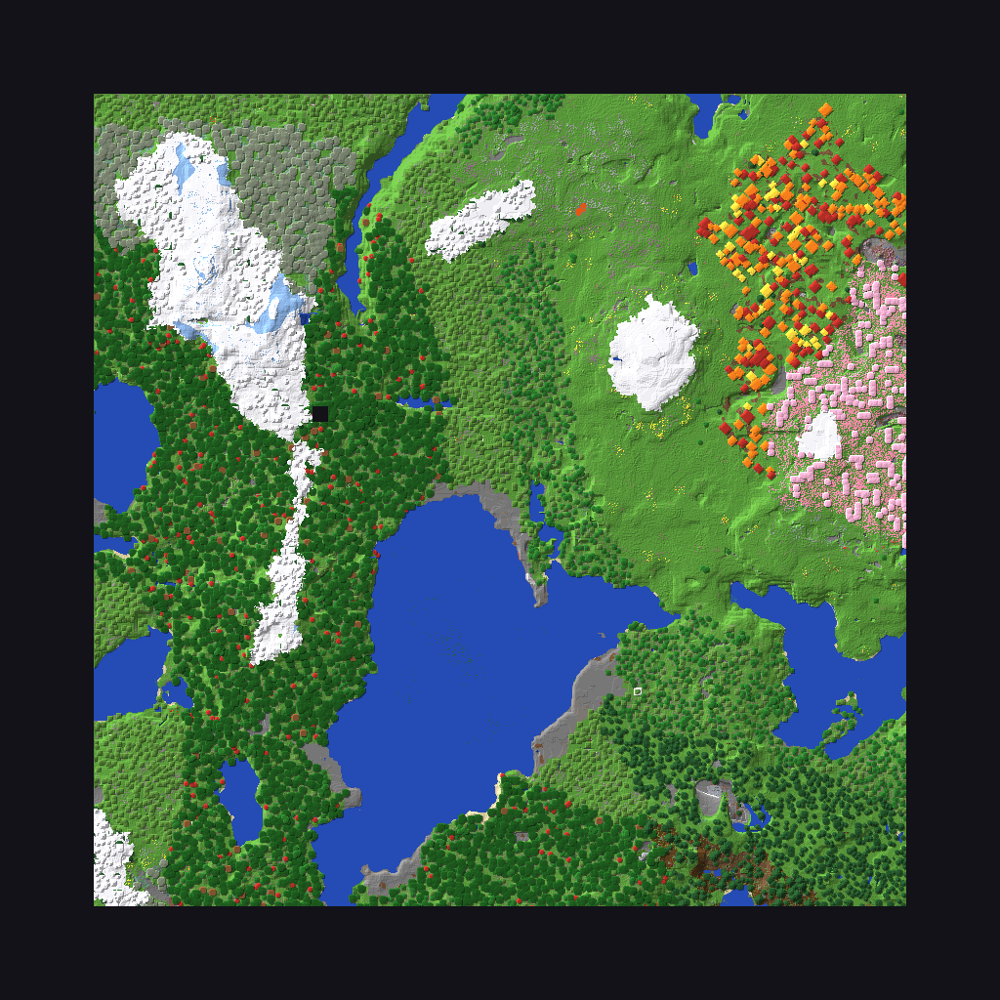

Here's how it appears after three backups in plakar:

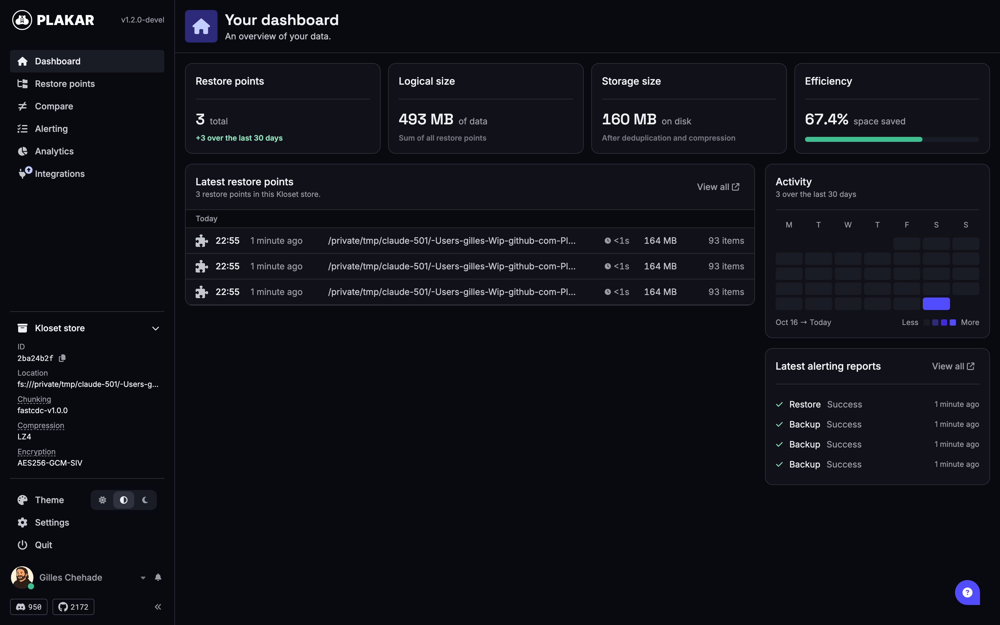

And picking into server directory, world folder and region files:

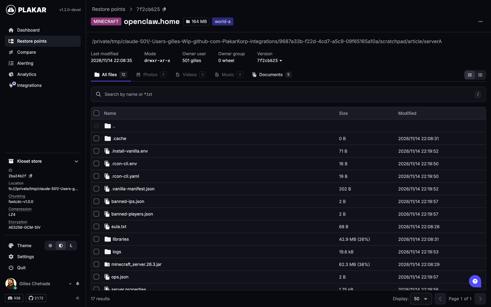
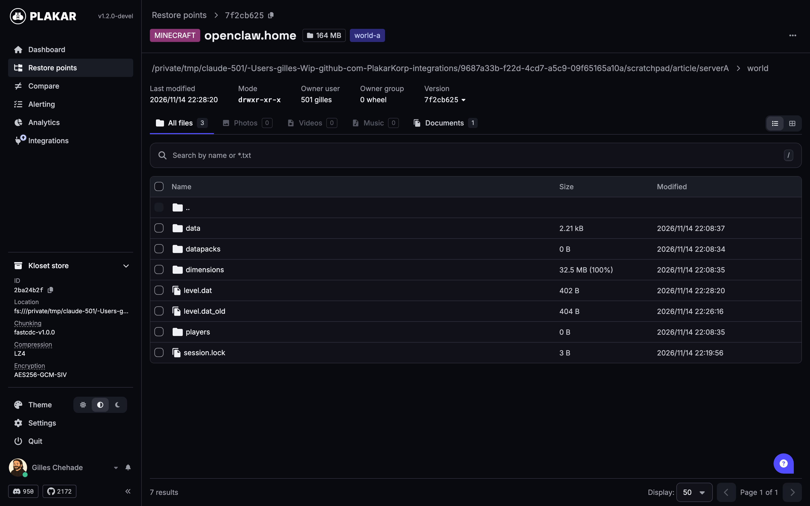
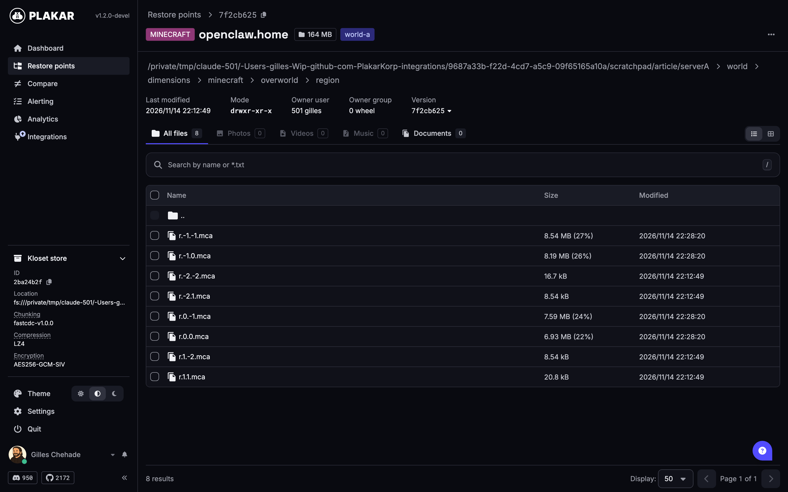

With a preview of the EULA and properties:

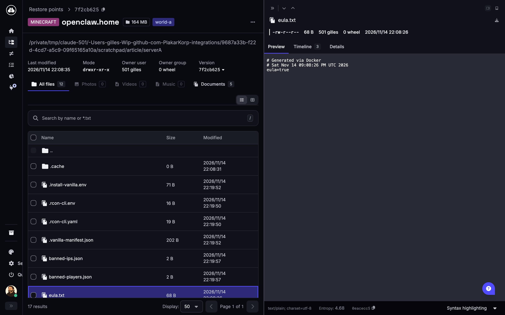
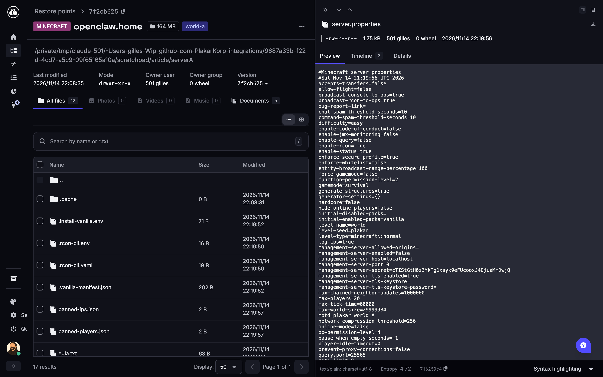

## Restoring

Restores refuse to write into a directory where a server is running, because writing region files under a live server is the fastest way to corrupt a world. Stop it first.

Restoring the whole server where it was:

```
$ plakar at /var/backups/minecraft restore -to minecraft:///srv/minecraft \
  <snapid>:/srv/minecraft/
```

Someone blew up spawn last night but the rest is fine ? Restore only the overworld:

```
$ plakar at /var/backups/minecraft restore -to minecraft:///srv/minecraft \
  <snapid>:/srv/minecraft/world
```

And moving the server to another machine is the same command, pointed at wherever the repository lives:

```
$ plakar at s3://backups/minecraft restore -to minecraft:///srv/minecraft \
  <snapid>:/srv/minecraft/
```

So you can technically use `plakar` as a minecraft server migration tool :-)

There's an `allow_running` option on the exporter to restore files the server doesn't hold open, a plugin configuration for example, without stopping it.
It's there for that and nothing else, don't come complaining if you use it on a world and hell breaks loose.

Here's a screenshot of a world after restore, identical to the previous one:

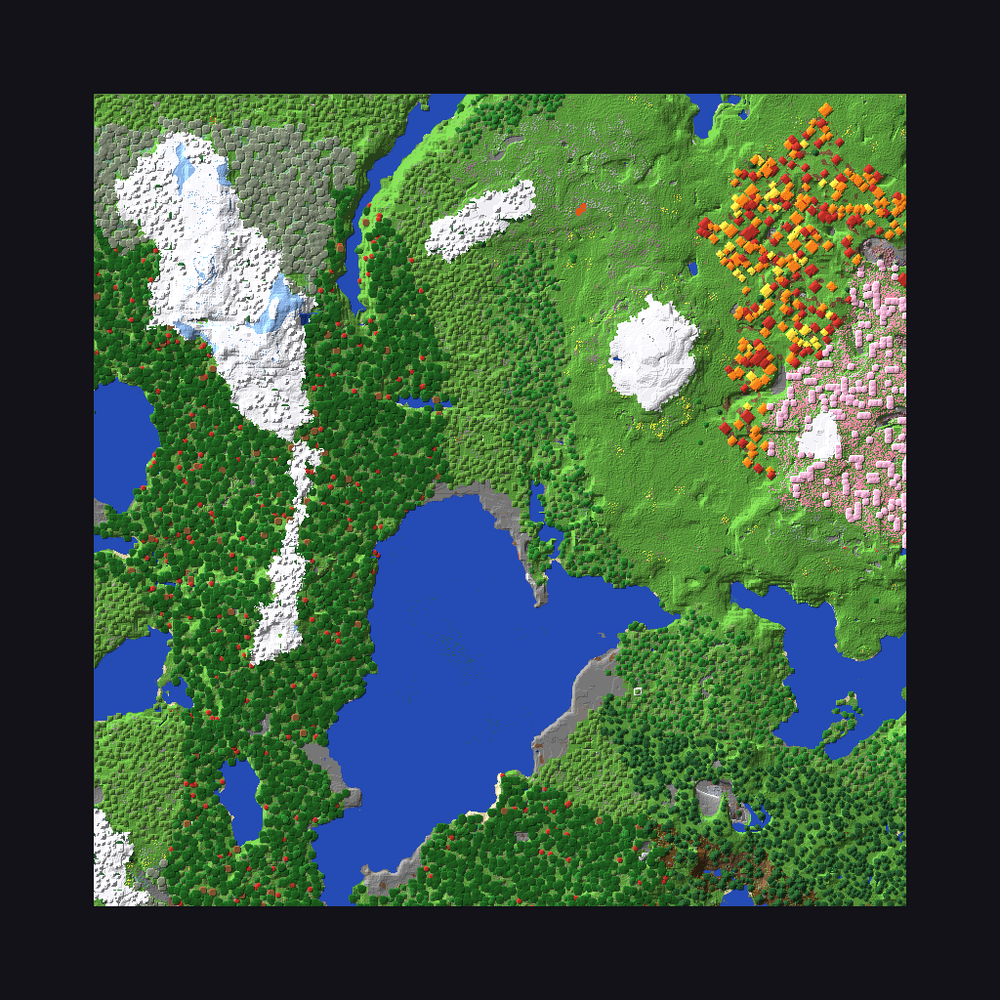

## A few knobs

Most setups won't need any of these, but on the importer `quiesce` (on by default) can be turned off to copy the directory as is whatever the server is doing, `rcon` sets the console address if it's not the one from `server.properties`, `timeout` (5 minutes by default) is the time allowed for each console exchange because `save-all flush` on a large world takes a while, and `dont_traverse_fs` keeps it from following mount points under the directory.

The exporter has `allow_running`, `rcon` and `timeout` (30 seconds there), plus the usual `skip_ownership`, `skip_permissions` and `skip_times` from `fs`.

As usual,
don't use an option if you don't know that you need it,
the defaults should be fine for most.


## Things you should know

If plakar is killed between `save-off` and `save-on`, saving stays off until someone runs `save-on` on the console. A cancelled backup turns it back on by itself, a crash cannot… so if your backups run unattended, it's worth keeping an eye on.

A server in a container on Docker Desktop holds its world locks inside the Docker VM where the host can't see them, so there the connectors only know the server is up through the console. Keep RCON enabled and published.

Finally, worlds on a Bukkit, Spigot or Paper server are three directories, `world`, `world_nether` and `world_the_end`, and they should be restored together unless you enjoy Nether portals leading nowhere.

All of this was tested with vanilla 26.3 in the `itzg/minecraft-server` image: a backup of the live server with saves paused, a restore refused while it ran, then a restore of the snapshot into a new directory and a server booted from it with the same seed and the same world \o/


## WAIT ! WHAT ABOUT USING MINECRAFT AS A STORE ?

If you've followed me for a while, you know that I like stupid :-)

Technically, nothing prevents us from using a minecraft server as a store for backups and encode the data as blocks to be turned into a walkable landscape.

Is it useful ? nopes.
Shall we do it ? yes, we MUST.

I present to you the stupidest idea of this week-end: **backups as a world**.


## The world is the store

Backing up a Minecraft server is the sensible half of this integration.
The other half is half a joke, half a technical demonstration: if plakar can back up a world, could a world be the thing plakar backs up *to* ?
Not a folder on the server, the world itself. Blocks.

It turns out the storage contract makes that easier than it sounds.
A kloset store has to do very little: hold packfiles and states, give them back by content address, serve a byte range out of a packfile, list what it has, delete what it is told to. It does not care what the bytes are stored *as*. The fs store writes files, the S3 store writes objects, and nothing in kloset would notice if a store wrote terrain. So the problem is not plumbing, it is a codec to translate our bytes back and forth to something sensible.

### Two bytes per column

Every column of a Minecraft world, every x and z, carries two bytes. The low nibble of the first byte is a height: that many blocks of stone above a base at y=64. On top of the stone sit three blocks, a stained glass, a terracotta and a concrete, and each comes in sixteen colours, so the remaining three nibbles are colours. A chunk is 256 columns, so it holds 512 bytes. A region file is 32 by 32 chunks, and chunk (0,0) of every region is a header that says which packfile or state this is, how long it is and where this region sits in it, encoded as terrain like everything else. The remaining 1023 chunks hold 511 KiB of payload.

A packfile is placed by hashing its address into region coordinates, so there is no catalog to keep in sync: listing the store is a scan of the region files and a read of each header chunk. Locks and the kloset configuration are plain files next to the world, because they change, and terrain is not meant to.


That is eight region files of my plakar checkout, seen from above at one pixel per block.
Since plakar compresses and encrypts data before storing, this makes a surface that looks like noise, which is correct. The white squares in the corners are the header chunks: the padding after a header is zeros, and a zero column is white glass, white terracotta and white concrete on no stone at all.

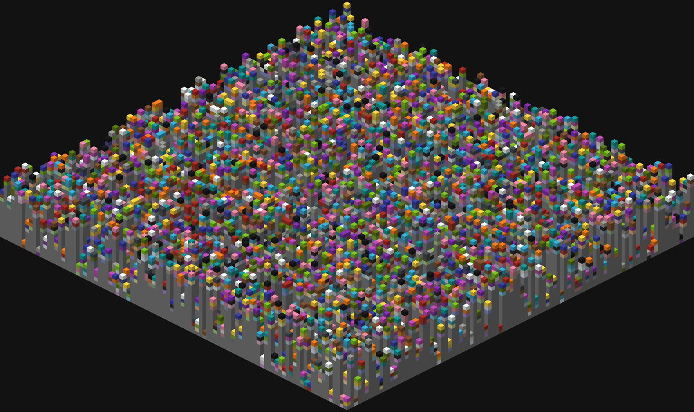

Up close it is a field of pillars, each one a column of stone with three coloured blocks on top. This is what a player walks across (or at least tries to walk across :p). The heights are a nibble so the hills stay walkable, and nothing in the palette falls, burns, flows, spreads or gets picked up by an enderman, because the server will keep running on this world and the bytes have to survive it.

### Why not a solid cube

The dense version of this is obvious: 256 block types, one byte per block, 96 MiB per region, and we're done.
It would also be a solid cube of static nobody can walk on, and walking on your backups is the whole point otherwise... it's boring and no fun.
Terrain costs density,
two bytes per column instead of one per block,
and the region files on disk come out at roughly ten times the kloset.
We're not building something serious here so it's fine, I'll trade space for lulz.

The more interesting constraint is that a running server does not leave region files alone. It relights chunks it loads, it rewrites them on save, and when you upgrade the server it runs every chunk through its data fixers. So the codec cannot depend on how a chunk is laid out on disk, only on which block is where.

### Read-only, in the Minecraft sense

Players cannot be allowed to change a byte, otherwise they break the store.
That is three layers:

- The server runs in forced adventure mode, where blocks cannot be broken or placed.
- The gamerules the store writes into `level.dat` stop random ticks, fire, weather, mob spawning and mob griefing, so nothing grows, melts, burns or wanders off with a block.
- And the palette is inert on its own.

If something gets through anyway, kloset verifies every read against its address, so a creeper that edits a packfile produces an error, not a quietly wrong restore.

### Does it actually work

```
$ plakar at minecraft:///srv/minecraft create
$ plakar at minecraft:///srv/minecraft backup ./plakar
$ plakar at minecraft:///srv/minecraft backup ./plakar
$ plakar at minecraft:///srv/minecraft backup ./plakar
$ plakar at minecraft:///srv/minecraft ls
2026-11-14T21:57:05Z   b81e9a60   106 MiB        0s /Users/gilles/Wip/github.com/PlakarKorp/plakar
2026-11-14T21:57:03Z   703d4848   106 MiB        1s /Users/gilles/Wip/github.com/PlakarKorp/plakar
2026-11-14T21:56:15Z   881849ce   106 MiB        1s /Users/gilles/Wip/github.com/PlakarKorp/plakar

$ plakar at minecraft:///srv/minecraft cat b81e9a60:/Users/gilles/Wip/github.com/PlakarKorp/plakar/README.md
<div align="center">


# Plakar: open source backup engine

**Encrypted, deduplicated, verifiable, and scalable.**

Back up anything, store anywhere, restore everywhere, with zero-trust encryption and no vendor lock-in.
...
## What is Plakar?

Plakar is an open-source backup solution powered by Kloset and ptar. It creates snapshots of your data, stores them in an encrypted and deduplicated store, and lets you inspect, verify, and restore them later.
```

It does. Three backups of the checkout went in, deduplicated as usual, and `ls` and `cat` came back out working just like they would on a filesystem or an S3 store.

More interestingly, I launched the UI on the minecraft server store:

```
$ plakar at minecraft:///srv/minecraft ui
```

and you can browse the snapshots and preview files:

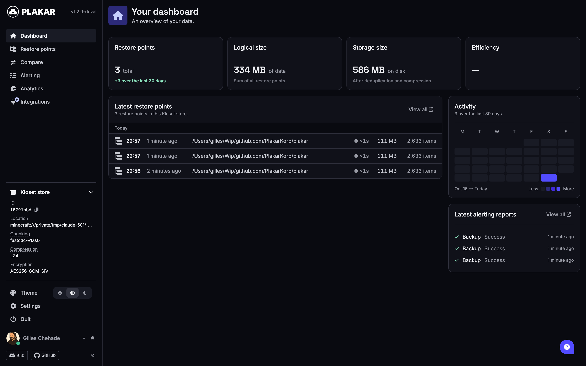
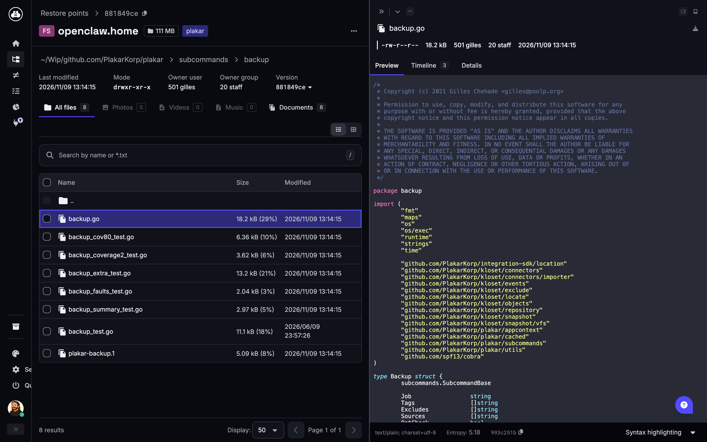


### What this is for

Nothing, mostly. It is a toy, and I am fond of it. But it is an honest toy: it exists because the store contract is narrow enough that anything which can hold bytes and hand them back by offset can be a kloset, and the integrity checks are strong enough that a store you do not trust, like a world full of players, is still safe to restore from. Those are the properties that make plakar work on the stores that matter. This one just happens to have hills.

Do backup your minecraft servers, and do restore them.

**DON'T store your backups on a minecraft server as world, really, DON'T :-)**


## What's next ?

It's in the devel channel for now, so give it a try and tell me what breaks, issues and pull requests go to the `integration/minecraft` branch of [poolpOrg/plakar-integrations](https://github.com/poolpOrg/plakar-integrations).

As for the series, I'll keep picking random projects and generating connectors for them every now and then. If there's something you value and would like to see backed up, tell me… or better, grab the SDK and the docs and beat me to it: I'll make sure the authors of the funniest integrations get their goodies :-)

Stay tuned !