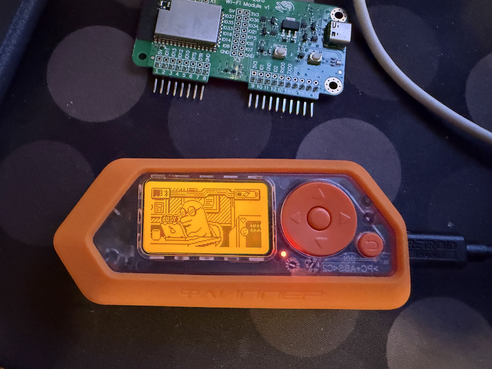
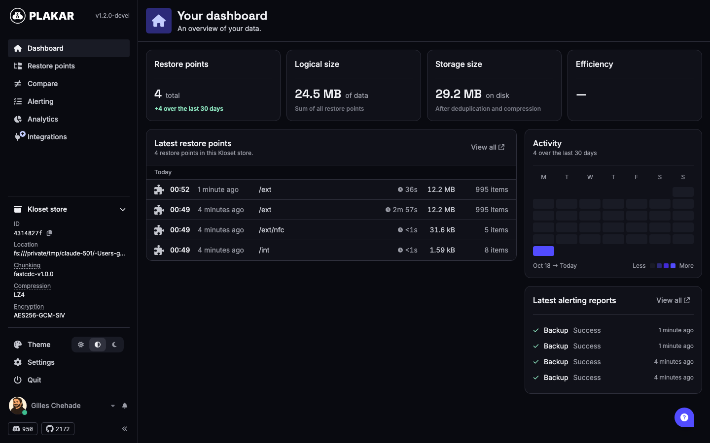
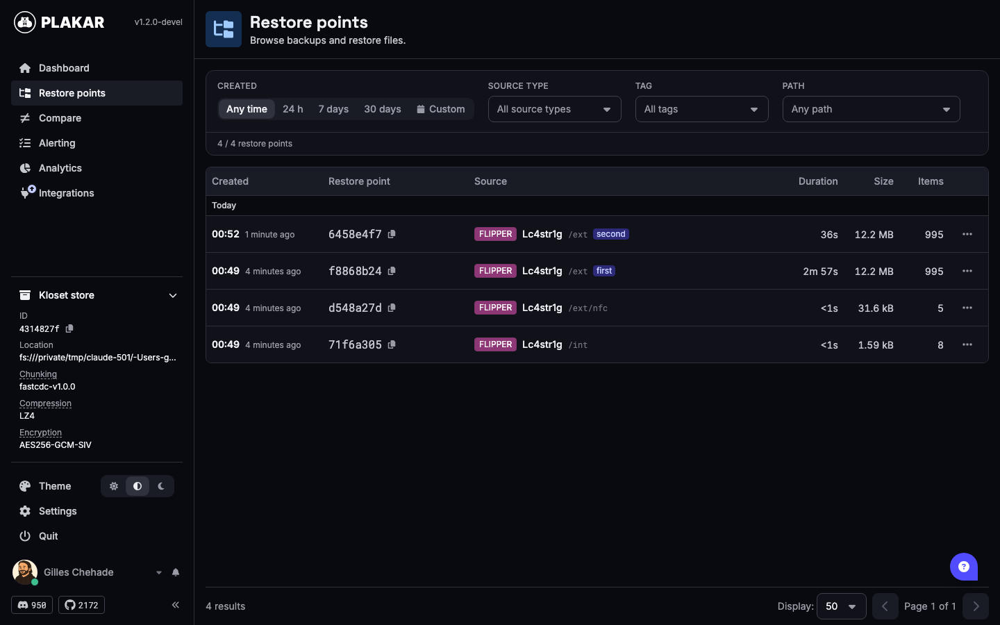
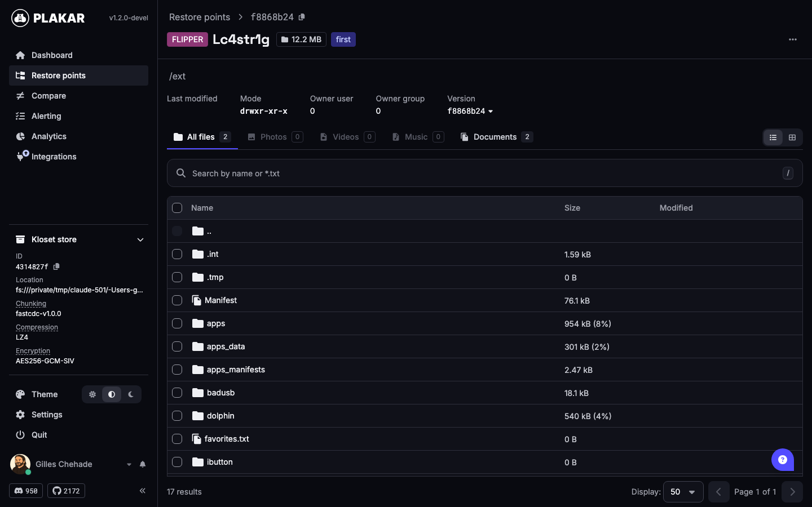
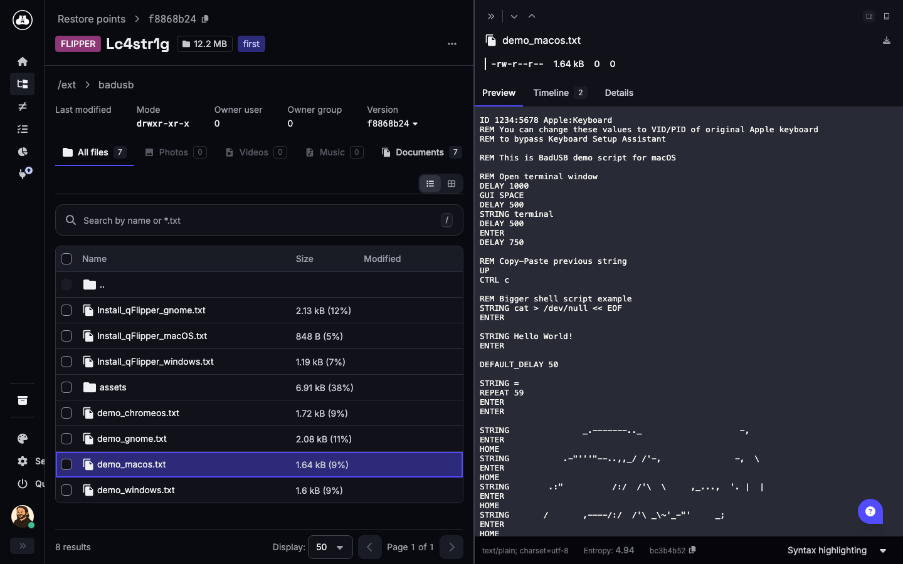
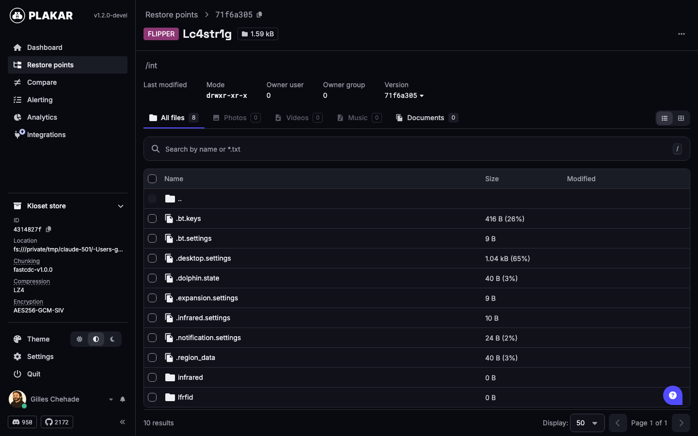
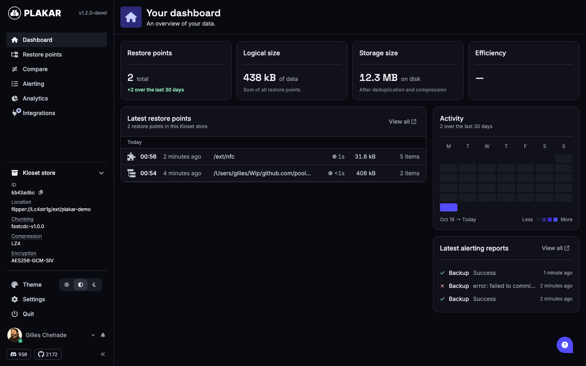
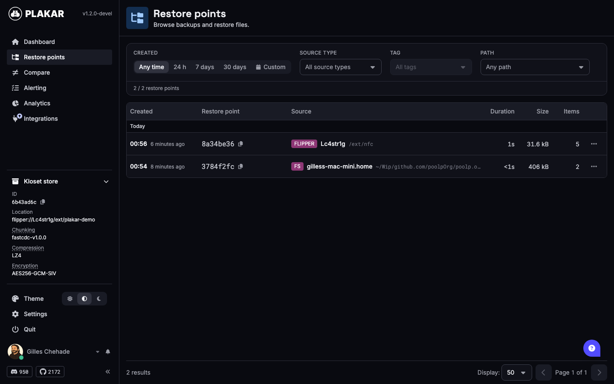
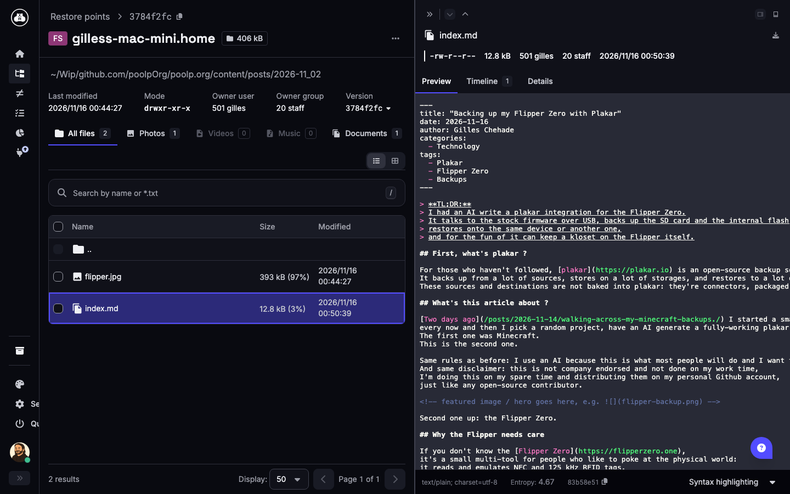
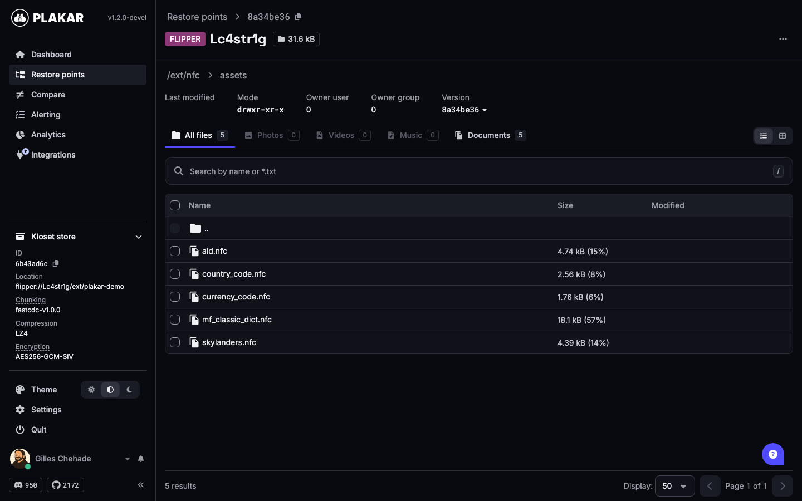

> **TL;DR:**
> I had an AI write a plakar integration for the Flipper Zero.
> It talks to the stock firmware over USB, backs up the SD card and the internal flash,
> restores onto the same device or another one,
> and for the fun of it can keep a kloset on the Flipper itself.

## First, what's plakar ?

For those who haven't followed, [plakar](https://plakar.io) is an open-source backup solution, ISC-licensed, written in Go and built on top of kloset, a content-addressed storage engine that deduplicates, compresses and encrypts everything it stores and keeps snapshots immutable.
It backs up from a lot of sources, stores on a lot of storages, and restores to a lot of destinations: a filesystem, an S3 bucket, an SFTP server and many more...
These sources and destinations are not baked into plakar: they're connectors, packaged as integrations that anyone can write and install.

## What's this article about ?

[Two days ago](/posts/2026-11-14/walking-across-my-minecraft-backups./) I started a small series:
every now and then I pick a random project, have an AI generate a fully-working plakar connector for it, and make it available to the community.
The first one was Minecraft.
This is the second one.

Same rules as before: I use an AI because this is what most people will do and I want to show that there's no excuse not to protect your data, whatever it is, even if you're not a programmer.
And same disclaimer: this is not company endorsed and not done on my work time,
I'm doing this on my spare time and distributing them on my personal Github account,
just like any open-source contributor.

Second one up: the Flipper Zero.

## Why the Flipper needs care

If you don't know the [Flipper Zero](https://flipperzero.one),
it's a small multi-tool for people who like to poke at the physical world:
it reads and emulates NFC and 125 kHz RFID tags,
records and replays sub-GHz remotes,
learns infrared codes,
clones iButton keys,
runs BadUSB scripts,
and has GPIO pins for whatever else you want to plug on it.



Everything it captures lands on a microSD card:
the badge of the office,
the garage remote,
the TV codes, the iButton of the building, your custom apps and their settings.
Years of it, on one card, in one device that lives in a pocket or a bag and that gets lost, dropped, or reflashed.

The official desktop app can save the internal flash,
and for the SD card the usual advice is to pull it out and copy it,
which nobody does on a regular basis,
or to drag files around in its file manager by hand.
Nothing versions it, nothing deduplicates it, nothing encrypts it,
and the day the card stops mounting is the day you find out what you lost.

plakar already knows how to take a tree of files, deduplicate it, encrypt it and push it wherever you want.
The missing piece was reading that tree from the device without touching the card.

## Here's the prompt that was used

This is the prompt that produced the integration:

```
Write an integration to backup my flipper zero with Plakar.

It should support backup and restore.

Write full tests coverage and do a roundtrip test by backing up,
restoring and comparing before and after.
```

As with Minecraft it's under-specified,
but with the SDK and the other integrations to look at it is enough to get something functional..

## How does it work ?

No app has to be installed on the Flipper, the stock firmware is enough.

When you plug a Flipper in, it shows up as a USB serial port with a command line on it.
One of the commands, `start_rpc_session`, switches the port from text to a protobuf RPC,
the same one the official desktop and mobile apps use to browse files, flash firmware and stream the screen.
That RPC has everything a backup needs: list a directory, stat a file, read it, write it, mkdir, delete, rename,
and on recent firmwares, ask the device for the MD5 of a file.

The integration finds the device on the USB bus by its vendor and product id,
wakes the CLI up, waits for its prompt, sends the command, and from there speaks protobuf until it's done,
at which point it hands the port back to the CLI so that the next client finds a prompt.
When it finishes a backup or a restore, it asks the device to blink and buzz,
the way the desktop app does when a transfer completes.
It's not strictly necessary but it's fun,
so there it is :-p

<center>
<video controls playsinline>
  <source src="flipper-buzz.mp4" type="video/mp4">
  Your browser does not support the video tag.
</video>
</center>

The three connectors are then thin:

- the **importer** walks a directory of the device and backs it up
- the **exporter** restores a snapshot onto the device
- the **storage** keeps a kloset on the device, more on that below

## Installing

The package is built and available in the devel channel, so installing it is a one-liner:

```
$ plakar pkg add -devel flipper
```

If you'd rather build it yourself, the code lives on the `integration/flipper` branch of [poolpOrg/plakar-integrations](https://github.com/poolpOrg/plakar-integrations) and `make install` packages it and installs it in your local plakar:

```
$ git clone -b integration/flipper https://github.com/poolpOrg/plakar-integrations
$ cd plakar-integrations/flipper
$ make install
```

## Locations

On the device, `/ext` is the SD card and `/int` the internal flash where the settings and the dolphin state live.
The locations follow that:

```
flipper://                         /ext on whichever Flipper is plugged in
flipper:///ext/nfc                 a directory on the SD card
flipper://int                      the internal flash
flipper://Lc4str1g/ext/subghz      a specific device when several are plugged in
```

The device name is the one printed on the device info screen or in the USB serial number,
with or without the `flip_` prefix.
With a single Flipper plugged in you never have to type it,
with two the integration refuses to guess and lists them so you can pick.

If the USB detection doesn't work for you, `port` bypasses it:

```
$ plakar backup -o port=/dev/cu.usbmodemflip_Lc4str1g1 flipper://
```

## Backing up

Assuming a repository was created with `plakar at /var/backups/flipper create`,
plug the Flipper in and back up the SD card:

```
$ plakar at /var/backups/flipper backup flipper://
```

Only the NFC dumps, and the settings from the internal flash:

```
$ plakar at /var/backups/flipper backup flipper:///ext/nfc
$ plakar at /var/backups/flipper backup flipper://int
```

What changed since last time:

```
$ plakar at /var/backups/flipper diff <snapid1> <snapid2>
```

Here's what the UI shows after a few of these, the source shows up as the device name:




Browsing the SD card of a snapshot, this is the familiar Flipper layout with `badusb`, `nfc`, `subghz`, `infrared` and friends:



With a preview of one of the BadUSB demo scripts:



And the internal flash, settings and all:



Now for the part that makes it usable:

The Flipper reports neither modification times nor permissions,
so every file comes out with `0644`, directories with `0755`,
and there's no mtime to tell plakar that a file hasn't changed since the last backup.
The link is also not fast: it's a USB serial port moving data in 512 byte frames,
every round-trip costs about 50 ms whatever the request,
and bulk transfers run at roughly 120 KB/s in both directions.
Re-reading a full SD card on every backup is not something you want to do nightly.
On my Flipper the card holds 12 MiB in a bit under a thousand files, nothing dramatic, and the first backup still took just under three minutes.

With `md5` enabled, which is the default, every file gets a fixed epoch modification time and its on-device MD5 is kept where plakar's backup cache expects the inode and device numbers.
From then on, a file whose MD5 hasn't changed is skipped without being transferred,
and the second backup of a card that didn't move costs one listing per directory and nothing else.
That same card, backed up again right after: 36 seconds, all of it spent listing.
Recent firmwares hand the MD5 out with the listing,
older ones cost one round-trip per file,
which is still far cheaper than reading it.

Turn `md5` off and every backup re-reads everything,
slower but it spares the device one hashing pass per file.
I don't see why you'd want that, but the knob is there.

## Restoring

Restoring a snapshot onto the device:

```
$ plakar at /var/backups/flipper restore -to flipper:///ext <snapid>
```

And since the location names the device,
restoring onto another Flipper is the same command:

```
$ plakar at /var/backups/flipper restore -to flipper://OtherOne/ext <snapid>
```

So yes, this is also a way to migrate from one Flipper to another,
or to set up a second one identical to the first.
The exporter creates the directories it needs along the way and overwrites files in place.
Symbolic links don't exist on the device, so a snapshot that contains one gets an error for that entry and the rest is restored.

You can of course restore a subset, here the BadUSB scripts into a fresh directory on the card:

```
$ plakar at /var/backups/flipper restore -to flipper:///ext/restore-demo \
  f8868b24:/ext/badusb
f8868b24: OK ✓ /Install_qFlipper_macOS.txt
f8868b24: OK ✓ /demo_macos.txt
...
f8868b24: OK ✓ /assets/layouts/tr-TR.kl
```

Four seconds, and the device blinks and buzzes when it's done because bip bip bip bip !


## WAIT ! WHAT ABOUT USING THE FLIPPER AS A STORE ?

If you read the Minecraft article, you know where this is going.

The kloset storage contract is narrow:
hold packfiles and states, give them back by content address, serve a byte range out of a packfile, list what's there, delete what you're told to.
A microSD card behind a serial port can do all of that.
Sloooooooooowly, but it can.

So, with the folder of this very article as the thing to protect:

```
$ plakar at flipper:///ext/plakar create
$ plakar at flipper:///ext/plakar backup ./content/posts/2026-11_02
3784f2fc: backup completed without errors in 1m36s (in: 397 KiB, out: 397 KiB)
```

A minute and a half for 400 KiB, the serial link is a new kind of painful...
but it's still good enough to do this:

```
$ plakar at flipper:///ext/plakar backup flipper:///ext/nfc
8a34be36: backup completed without errors in 1.17s (in: 0 B, out: 3.6 MiB)
$ plakar at flipper:///ext/plakar ls
2026-11-15T23:56:56Z   8a34be36    31 KiB        1s /ext/nfc
2026-11-15T23:54:38Z   3784f2fc   397 KiB        0s /Users/gilles/Wip/github.com/poolpOrg/poolp.org/content/posts/2026-11_02
```

A backup of the Flipper, into a kloset on the Flipper, over the one serial port, with two connector processes sharing it.
Is it useful ? Nope.
Does it work ? Yes.
Even the UI runs on it, every packfile it needs is fetched from the SD card through the RPC:

```
$ plakar at flipper:///ext/plakar ui
```



The two restore points, one from my Mac and one from the Flipper itself, both sitting on the SD card:



Previewing this very article, read back from the card through the RPC, packfile by packfile:



And the Flipper's NFC assets, backed up from the Flipper, onto the Flipper, browsed from the Flipper,
inception style:




A few details:

- the layout on the card is flat, `packfiles/`, `states/`, `locks/` and a `CONFIG` file,
  where the regular filesystem store fans out into 256 bucket directories,
  which over this link would have been 512 mkdir round-trips just to create the repository
- a packfile is written next to its final name then renamed,
  so a transfer cut short leaves a stray `.tmp` rather than a truncated packfile that would list as valid
- the RPC has no ranged read, so fetching one blob means reading the whole packfile.
  The last few packfiles are kept in memory for the next blobs, bounded in count and in bytes

It's a toy, not a backup target.
Encrypted, deduplicated snapshots of your notes on a dolphin is funny, but relying on it is not.
**DON'T store your backups on a Flipper, they will sink at the bottom of the sea :-)**

## Things you should know

The device is slow, really.
A first backup of a full card takes a while, three minutes for my 12 MiB, go do your laundry.
The second one is fast thanks to the MD5 trick, as long as you leave `md5` on.

If something crashed mid-session and the Flipper stays in RPC mode,
the integration won't find the CLI prompt and will tell you to unplug and plug it back.
That's the firmware side of the handshake, there's nothing to clean up on the host.

Everything was tested with an in-memory fake of the device for the unit tests, on Linux, macOS and Windows in CI,
and on a real Flipper for the round trip:
a backup of the SD card, a restore onto the device, and a kloset created and used on the card.

## What's next ?

It's in the devel channel for now, so give it a try and tell me what breaks,
issues and pull requests go to the `integration/flipper` branch of [poolpOrg/plakar-integrations](https://github.com/poolpOrg/plakar-integrations).

As for the series, two down, I'll keep picking random projects and generating connectors for them.
If there's something you value and would like to see backed up, tell me…
or better, grab the SDK and the docs and beat me to it: I'll make sure the authors of the funniest integrations get their goodies :-)

Stay tuned !
